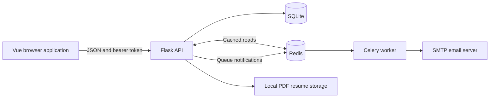
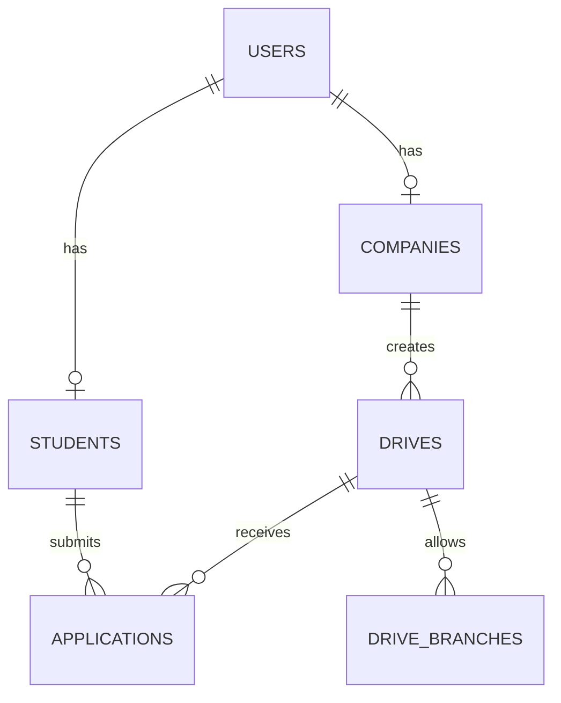

# Placement Portal

A campus recruitment application connecting an institute's placement cell, recruiting companies, and students. Companies submit recruitment drives, administrators approve them, and eligible students apply and track their application status.

The project uses a Vue frontend and a Flask JSON API, with SQLite for application data, Redis for caching and job queues, and Celery for email notifications.

## Contents

- [Features and workflow](#features-and-workflow)
- [Architecture and technology](#architecture-and-technology)
- [Repository structure](#repository-structure)
- [Local setup](#local-setup)
- [First-use walkthrough](#first-use-walkthrough)
- [Data model](#data-model)
- [API overview](#api-overview)
- [Background jobs and caching](#background-jobs-and-caching)
- [Verification and troubleshooting](#verification-and-troubleshooting)
- [Current limitations](#current-limitations)

## Features and workflow

| Role | Available functionality |
| --- | --- |
| Institute administrator | Review companies; approve, reject, or blacklist them; approve or reject drives; inspect students; view dashboard totals and placement reports. |
| Company | Register an account, maintain a company profile, create drives after approval, review applications and resumes, shortlist or reject applicants, record final decisions, send interview notifications, and download a CSV report. |
| Student | Register, update academic details and skills, upload a PDF resume, browse drives with eligibility information, apply, track decisions, change passwords, and download application history as CSV. |

The normal recruitment flow is:

1. A company registers with a `pending` approval status.
2. An administrator approves the company.
3. The company creates a drive with a job description, package, location, branches, CGPA criterion, and deadline.
4. An administrator approves the drive.
5. A student applies; the API checks the student's role, drive approval, deadline, allowed branch, and duplicate application.
6. The company moves the application from `applied` to `shortlisted`, `selected`, or `rejected`. Interview notifications are available for shortlisted applications.

CGPA is used in the drive-listing eligibility calculation, but the application endpoint does not repeat that check. See [Current limitations](#current-limitations).

## Architecture and technology



| Layer | Technology |
| --- | --- |
| Frontend | Vue 3, Vue Router, Vite 8, Font Awesome, browser Fetch API |
| Backend | Flask, Flask-SQLAlchemy, Flask-JWT-Extended, Flask-CORS |
| Authentication | JWT bearer tokens and Werkzeug password hashing |
| Database | SQLite, accessed through SQLAlchemy models |
| Background processing | Celery with Redis broker and result backend |
| Email | Python `smtplib`, STARTTLS, SMTP credentials loaded with `python-dotenv` |

## Repository structure

```text
Placement_portal/
|-- backend/
|   |-- app.py                    # Flask configuration, login, password, resume routes
|   |-- database.py               # SQLAlchemy instance
|   |-- model.py                  # Users, students, companies, drives, applications
|   |-- cache_utils.py            # Redis cache helpers
|   |-- routes/
|   |   |-- admin_routes.py
|   |   |-- company_routes.py
|   |   `-- student_routes.py
|   `-- backend_jobs/
|       |-- celery_app.py
|       |-- notifications.py      # Queueing wrappers
|       `-- tasks.py              # Email, reminder, and export task definitions
|-- frontend/
|   |-- src/views/                # Login, registration, and role-specific screens
|   |-- src/components/           # Dashboard layouts and navigation
|   |-- src/router/index.js
|   |-- package.json
|   `-- vite.config.js
|-- requirements.txt
`-- CELERY_SETUP.md
```

Runtime data is created under `backend/instance/`: `placement.db` contains application records and `resumes/` contains uploaded PDFs. These are generated files, not required source assets.

## Local setup

### 1. Prerequisites

- Python 3.11 or 3.12 is a recommended starting environment. Python dependencies are currently unpinned.
- Node.js satisfying `^20.19.0 || >=22.12.0`, as declared in [frontend/package.json](frontend/package.json).
- npm, Git, and Redis on `localhost:6379`.
- An SMTP account if you want email delivery to work.

For Windows, WSL is the preferred environment for Redis and Celery. The Flask API and Vue frontend can also run in PowerShell. The backend, worker, and Redis must be able to reach the same configured broker.

```bash
git clone https://github.com/23f3002149/Placement_portal.git
cd Placement_portal
python -m venv .venv
```

Activate the environment in PowerShell:

```powershell
.\.venv\Scripts\Activate.ps1
```

Or on macOS/Linux:

```bash
source .venv/bin/activate
```

Then install Python dependencies from the repository root:

```bash
python -m pip install -r requirements.txt
```

### 2. Configure the backend

Set these values in your local `backend/.env`. The following values illustrate the format; replace the SMTP placeholders with your own configuration.

```dotenv
CELERY_BROKER_URL=redis://localhost:6379/0
CELERY_RESULT_BACKEND=redis://localhost:6379/0
SMTP_HOST=smtp.example.com
SMTP_PORT=587
SMTP_USER=notifications@example.com
SMTP_PASS=your-local-smtp-password
ADMIN_EMAIL=placement-admin@example.com
```

| Setting | Use |
| --- | --- |
| `CELERY_BROKER_URL` | Redis queue URL; defaults to database `0` on localhost. |
| `CELERY_RESULT_BACKEND` | Celery result storage; defaults to the same Redis URL. |
| `SMTP_HOST`, `SMTP_PORT` | SMTP host and STARTTLS port; port defaults to `587`. |
| `SMTP_USER`, `SMTP_PASS` | SMTP authentication and sender identity. |
| `ADMIN_EMAIL` | Recipient for placement-cell application notifications. |

The SQLite URI, JWT signing key, and cache Redis connection are currently configured in Python source. Setting a similarly named environment variable will not override them automatically. `backend/.env` is currently tracked: keep real credentials out of commits and replace any previously exposed credentials before deployment.

### 3. Start Redis

In a dedicated terminal on a system with Redis installed:

```bash
redis-server
```

### 4. Start the API

From the repository root with the Python environment active:

```bash
cd backend
python app.py
```

The server runs at `http://127.0.0.1:5000`. Starting `app.py` directly creates missing database tables. `GET /` returns `Placement Portal API`.

### 5. Start the Celery worker

In another terminal, activate the same environment and change into `backend/`:

```bash
python -m celery -A app:celery_app worker --loglevel=info
```

The explicit `app:celery_app` target loads the Flask module and its notification task imports. For a native Windows development attempt, append `--pool=solo`; WSL/Linux remains preferable for Celery.

### 6. Start the frontend

In another terminal, from the repository root:

```bash
cd frontend
npm ci
npm run dev
```

Open the URL printed by Vite, normally `http://localhost:5173`. The frontend currently calls `http://127.0.0.1:5000` directly. Keep the API on port `5000` unless you also update those URLs.

The frontend build commands are:

```bash
npm run build
npm run preview
```

The build is written to `frontend/dist/`. Preview serves that frontend build; the Flask API must run separately.

## First-use walkthrough

There is no automatically seeded administrator. With the local API running, create one through the existing bootstrap endpoint. This PowerShell example uses a placeholder password that you should replace for your local account:

```powershell
$body = @{
    name = 'Placement Admin'
    email = 'placement-admin@example.com'
    password = 'replace-with-your-local-password'
} | ConvertTo-Json
Invoke-RestMethod -Uri 'http://127.0.0.1:5000/admin' -Method Post -ContentType 'application/json' -Body $body
```

Use the frontend login screen and select the corresponding role. Student registration is available at `/register/student`, and company registration at `/register/company`.

For a complete local walkthrough, create one administrator, one company, and one student; approve the company and a future-dated drive; complete the student's profile; apply; and review the application as the company. Keep Redis and the worker running during notification-producing actions.

## Data model

| Model / table | Purpose and relationships |
| --- | --- |
| `User` / `users` | Shared identity with a unique email, password hash, and `admin`, `company`, or `student` role. |
| `Student` / `students` | One student profile per user; unique roll number, academic details, skills, and resume filename. |
| `Company` / `companies` | One company profile per user; company information and approval status. |
| `Drive` / `drives` | A company's recruitment opening, eligibility fields, deadline, and approval status. |
| `DriveBranch` / `drive_branches` | Branches allowed for a drive. |
| `Application` / `applications` | Joins a student and a drive; a composite uniqueness constraint prevents duplicate applications. |



## API overview

There is no `/api` prefix. Protected endpoints expect `Authorization: Bearer <token>`. Login accepts JSON containing `email`, `password`, and `role`, and returns a token and role.

| Area | Main endpoints |
| --- | --- |
| Accounts | `POST /login`, `POST /change_password`, `GET /profile` |
| Registration | `POST /admin`, `POST /company/register`, `POST /students/register` |
| Administrator | `GET /admin/dashboard`, `/admin/companies`, `/admin/students`, `/admin/drives`, `/admin/report` |
| Approvals | `PUT /admin/company/<company_id>/status`, `PUT /admin/drive/<drive_id>/status` |
| Company profile | `GET /company/info`, `PUT /company/profile` |
| Company workflow | `POST /company/drives`, `GET /company/dashboard`, `GET /company/applications` |
| Application decisions | `PUT /company/application/<app_id>/shortlist`, `/reject`, `/final` |
| Interviews | `POST /company/application/<app_id>/interview` |
| Student profile | `GET /student/info`, `PUT /student/profile`, `POST /student/resume` |
| Student workflow | `GET /student/dashboard`, `/student/drives`, `/student/applications`; `POST /student/apply/<drive_id>` |
| Downloads | `GET /student/report`, `GET /company/report/monthly`, `GET /resume/<filename>` |

Drive creation accepts a deadline in `YYYY-MM-DD` format. The interview endpoint expects `interview_time` as an ISO-format datetime. Resume upload uses multipart form data with the field `resume` and accepts filenames ending in `.pdf`.

See the [route modules](backend/routes/) for full request and response fields.

## Background jobs and caching

- Application submission queues a student confirmation and an administrator notification.
- Application decisions queue student status emails.
- Interview scheduling queues a notification, then a reminder **120 seconds after the scheduling task runs**, rather than a configurable interval before the interview.
- Email sending retries up to three times with a 60-second delay.
- Redis caches selected company/student profile and administrator list queries. Cache entries use 300- or 600-second TTLs, with invalidation on selected writes.
- If Redis is unavailable during cache initialization, cached reads fall back to database reads. Notification queueing still needs a working Redis broker.
- CSV download endpoints currently build responses synchronously. Export task definitions also exist in [tasks.py](backend/backend_jobs/tasks.py), but the download routes do not call them.
- No Celery Beat schedule is configured in the current code.

## Verification and troubleshooting

The repository currently has no automated test suite. Useful manual checks are:

1. Open the API root and frontend login page.
2. Exercise registration and the administrator/company/student workflow above.
3. Verify resume upload, application history, and CSV downloads.
4. Observe the Celery worker for queued notifications and SMTP errors.
5. Run `npm run build` from `frontend/` before publishing frontend changes.

| Symptom | What to check |
| --- | --- |
| `ModuleNotFoundError` | Activate the environment in each Python terminal and install the root `requirements.txt`. |
| `no such table` | Start `python app.py` from `backend/`; table creation is inside that startup path. |
| Redis connection failure | Confirm Redis is reachable on `localhost:6379` and the worker uses the same broker URL. |
| Notification task remains pending | Keep a worker running with the explicit `app:celery_app` target; inspect registered tasks and broker settings. |
| SMTP authentication failure | Check host, port, account credentials, and provider-specific SMTP/app-password requirements. |
| `Subject must be a string` / HTTP 422 after login | The current code creates JWTs with an integer identity. Recent PyJWT versions require string subjects; a code compatibility fix may be needed with unpinned dependencies. |
| Frontend cannot reach the API | Check the hardcoded `127.0.0.1:5000` URLs and browser network errors. |
| Application succeeds in the database but the request errors | Notification queueing happens after commit; check Redis before retrying the application. |

## Current limitations

This repository is a development/coursework application. The following behaviors matter when extending it:

- Administrator creation is unauthenticated, resume serving is public, and some company actions check role without verifying ownership of the target application. These require access-control changes before public use.
- Vue route guards inspect metadata, but protected dashboard routes do not currently declare the required role/authentication metadata.
- JWT configuration is hardcoded and development debug mode is enabled.
- The application endpoint does not enforce the CGPA criterion used in listing eligibility, and deadline dates are parsed at midnight.
- Interview times are passed to notification tasks but are not stored on an interview model or application field.
- The report labelled "monthly" currently includes all company applications, without a month filter.
- Resume validation checks the filename extension; size limits and content validation are not implemented.
- Python dependency versions are unpinned, and database migrations are not supplied. Existing [Celery notes](CELERY_SETUP.md) should be read alongside the current route/task behavior described here.

No license file is currently included in this repository.
